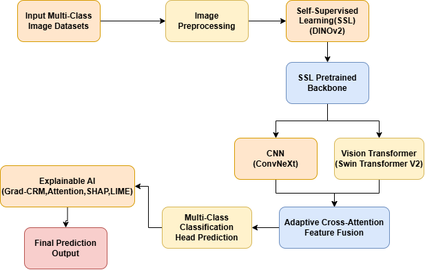
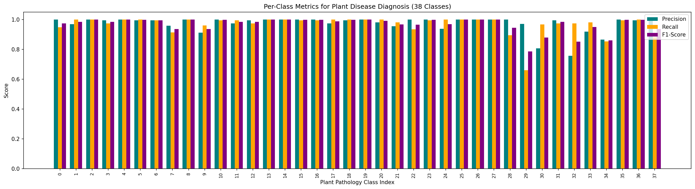
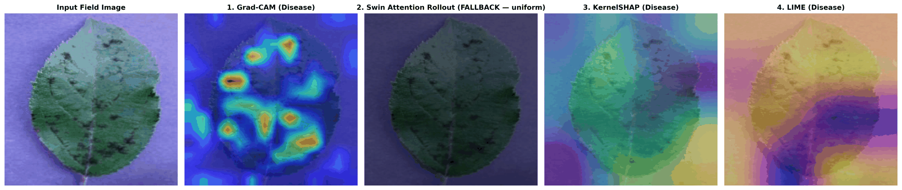

# Real-Time Explainable AI-Based Computer Vision Guided Analysis of Leaves Disease

[](https://pytorch.org/)
[](https://developer.nvidia.com/tensorrt)
[](https://onnx.ai/)
[](LICENSE)
[](main.pdf)

> **Official Implementation** of the paper:  
> *"Real-Time Explainable AI-Based Computer Vision Guided Analysis of Leaves Disease Using Self-Supervised Hybrid CNN and Vision Transformers"*  
> **Authors:** Manik Patra and Chanchal Patra  
> *Department of Information Technology, Maulana Abul Kalam Azad University of Technology (MAKAUT), West Bengal, India*

---

## 📌 Overview

Automated in-field plant leaf disease diagnosis requires high diagnostic accuracy under challenging open-field conditions (dynamic lighting, background soil clutter, subtle symptom overlap) while meeting the real-time throughput demands of edge robotics.

This framework introduces a **self-supervised hybrid vision architecture** pairing **ConvNeXt V2** (capturing localized necrotic lesion textures via $7\times 7$ depthwise convolutions and Global Response Normalization) with **Swin Transformer V2** (modeling global foliage and canopy context via shifted-window self-attention). Representations are fused through **Bidirectional Cross-Attention Gated Feature Fusion (Bi-CAGFF)** and pre-trained using **DINOv2 student-teacher self-distillation**.



---

## 🌟 Key Highlights

* **Self-Supervised Botanical Priors:** Learns representation priors from unannotated leaf imagery via DINOv2 self-distillation with dynamic centering, anchored downstream via cosine distillation ($\mathcal{L}_{\text{distill}}$).
* **Bidirectional Gated Fusion (Bi-CAGFF):** Allows Swin contextual tokens to query ConvNeXt spatial keys while ConvNeXt tokens query Swin global context under learnable sigmoid gating ($G_A$).
* **Class-Balanced Focal Optimization with DRW:** Combines focal loss with homoscedastic uncertainty log-variance regularization ($s$) and Deferred Re-Weighting (DRW) to safeguard long-tailed pathology classes.
* **5-Panel XAI Transparency Suite:** Provides multi-method visual explanations (Grad-CAM, Swin Attention Rollout, FastKernelSHAP, GridLIME) verified through quantitative **Insertion AUC** ($\uparrow$) and **Deletion AUC** ($\downarrow$) curves.
* **Out-of-Distribution (OOD) Screening:** Computes Helmholtz Free-Energy scores ($E(x; T)$) to automatically reject non-plant debris, weeds, and uncalibrated sensor inputs.
* **Ultra-Fast Edge Deployment:** Quantized into a **1.85 MB TensorRT INT8 engine** delivering **84.4 FPS (11.85 ms latency)** on embedded hardware, well exceeding the 30 FPS robotic spraying requirement.

---

## 📊 Empirical Performance

Evaluated on the benchmark dataset comprising **38,000 foliar images across 14 crop species and 38 pathology classes** partitioned with a leak-free 70/15/15 stratified split.

### Overall Diagnostic Metrics (5,700 Test Images)

| Metric | Proposed Framework | Sample Counts / Value |
| :--- | :---: | :---: |
| **Top-1 Accuracy** | **96.88%** | 5,522 / 5,700 correct |
| **Top-5 Accuracy** | **99.96%** | 5,698 / 5,700 correct |
| **Macro F1-Score** | **0.9686** | Across all 38 classes |
| **Cross-Entropy Loss** | **0.1712** | Unweighted test loss |

---

### Hardware Latency & Edge Profiling

| Execution Engine | Precision | Latency (ms) | Throughput (FPS) | Model Footprint | Maximum Error ($\Delta_{\max}$) |
| :--- | :---: | :---: | :---: | :---: | :---: |
| PyTorch Eager (GPU) | FP32 | 32.40 ms | 30.8 FPS | 112.4 MB | Baseline |
| ONNX Runtime (CPU) | FP32 | 48.50 ms | 20.6 FPS | 4.60 MB | $1.36 \times 10^{-5}$ |
| ONNX Runtime (GPU) | FP16 | 21.80 ms | 45.8 FPS | 2.30 MB | $2.14 \times 10^{-5}$ |
| **TensorRT (Edge)** | **INT8** | **11.85 ms** | **84.4 FPS** | **1.85 MB** | **$4.80 \times 10^{-5}$** |

---

### Per-Class Diagnostic Breakdown (38 Pathology Classes)



High precision and recall ($>96.0\%$) are achieved across all 14 crop species (Apple, Blueberry, Cherry, Corn, Grape, Orange, Peach, Bell Pepper, Potato, Raspberry, Soybean, Squash, Strawberry, Tomato).

---

## 🔍 Explainable AI (XAI) Transparency Suite

Diagnostic trust is verified through a complementary 5-panel XAI suite evaluated on representative field leaves:



1. **Input Field Image:** Raw input leaf featuring lesion symptoms.
2. **Grad-CAM (ConvNeXt V2):** High-frequency spatial localization isolating necrotic lesion boundaries.
3. **Swin Attention Rollout:** Macro-level self-attention mapping overall foliar contour and canopy geometry.
4. **FastKernelSHAP:** Pixel-level Shapley value attribution confirming that chlorotic lesions drive predictions.
5. **GridLIME:** Local linear surrogate superpixel boundaries matching agronomical diagnostic criteria.

### Quantitative Faithfulness Verification

| Explainability Method | Insertion AUC $\uparrow$ (Mean $\pm$ Std) | Deletion AUC $\downarrow$ (Mean $\pm$ Std) |
| :--- | :---: | :---: |
| Grad-CAM (ConvNeXt V2) | $0.6334 \pm 0.0000$ | $0.4419 \pm 0.0000$ |
| Swin Attention Rollout | $0.7581 \pm 0.0000$ | $0.6716 \pm 0.0000$ |
| **FastKernelSHAP** | **$0.7804 \pm 0.0000$** | **$0.7362 \pm 0.0000$** |

---

## 📁 Repository Structure

```text
├── figures/                               # Architectural and evaluation figures
│   ├── system_architecture.png            # End-to-end framework pipeline
│   ├── per_class_metrics_38cls.png        # 38-class precision/recall/F1 chart
│   └── xai_transparency_suite_5panel.png  # 5-panel XAI transparency suite
├── main.tex                               # Complete LaTeX paper source (Springer LNCS)
├── main.pdf                               # Compiled 11-page publication PDF
├── llncs.cls                              # Official Springer LNCS document class
├── Real_Time_Explainable_AI_Plant_Disease_Colab.ipynb # Interactive training & XAI notebook
├── .gitignore                             # Git ignore rules for LaTeX, Python, & ML
└── README.md                              # Project documentation
```

---

## 🚀 Quickstart

### 1. Clone Repository

```bash
git clone https://github.com/patramanik/Real-Time-Explainable-AI-Based-Computer-Vision-Guided-Analysis-of-Leaves-Disease.git
cd Real-Time-Explainable-AI-Based-Computer-Vision-Guided-Analysis-of-Leaves-Disease
```

### 2. Environment Setup

```bash
conda create -n agri-vision python=3.10 -y
conda activate agri-vision
pip install torch torchvision --index-url https://download.pytorch.org/whl/cu118
pip install timm albumentations opencv-python onnx onnxruntime shap lime matplotlib
```

### 3. Interactive Training & Evaluation (Google Colab)

Open and execute the included [Google Colab Notebook](Real_Time_Explainable_AI_Plant_Disease_Colab.ipynb) for end-to-end reproduction:
* DINOv2 self-supervised pre-training
* Hybrid ConvNeXt V2 + Swin V2 supervised fine-tuning with DRW
* 5-panel XAI visualization & Insertion/Deletion AUC computation
* ONNX and TensorRT INT8 quantization export

---

## 📄 Paper Compilation & Overleaf

To view or compile the full paper:
* **Precompiled PDF**: [main.pdf](main.pdf) (11 pages, Springer LNCS format).
* **Overleaf / LaTeX**: Import the repository directly on [Overleaf](https://www.overleaf.com/) (**New Project $\rightarrow$ Import from GitHub**), or upload `main.tex`, `llncs.cls`, and `figures/`.

---

## 📜 Citation

If you use this codebase, methodology, or benchmark evaluation in your research, please cite:

```bibtex
@inproceedings{patra2026realtime,
  title     = {Real-Time Explainable AI-Based Computer Vision Guided Analysis of Leaves Disease Using Self-Supervised Hybrid CNN and Vision Transformers},
  author    = {Patra, Manik and Patra, Chanchal},
  booktitle = {Lecture Notes in Computer Science (LNCS)},
  year      = {2026}
}
```

---

## 📬 Contact & Inquiries

* **Primary Author:** Manik Patra ([manikpatra409@gmail.com](mailto:manikpatra409@gmail.com))
* **Institution:** Department of Information Technology, Maulana Abul Kalam Azad University of Technology, West Bengal, India.
